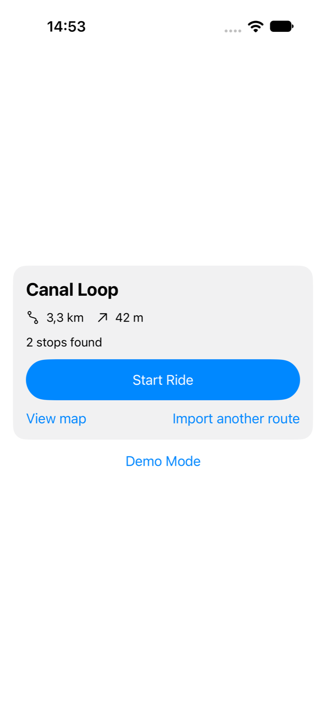
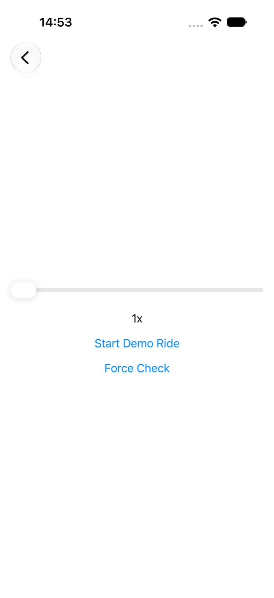
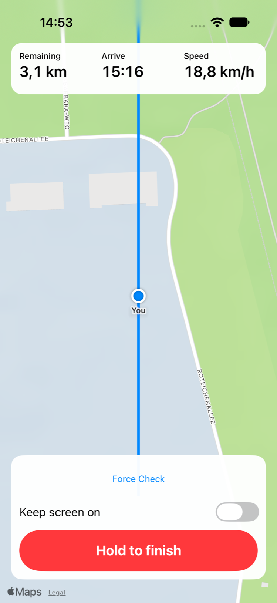
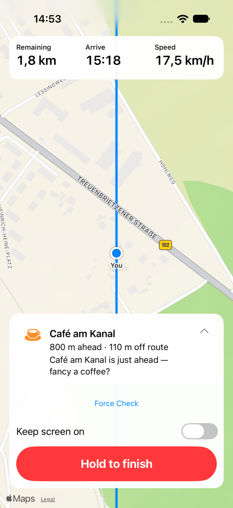
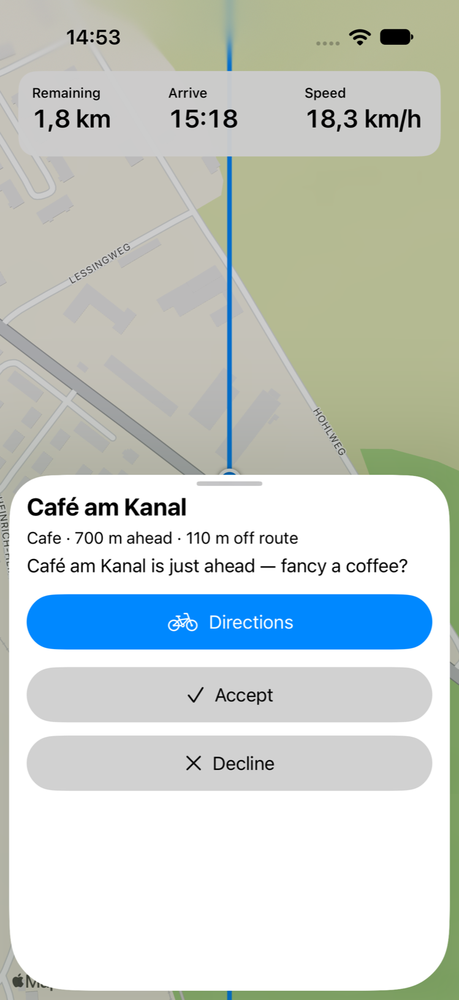
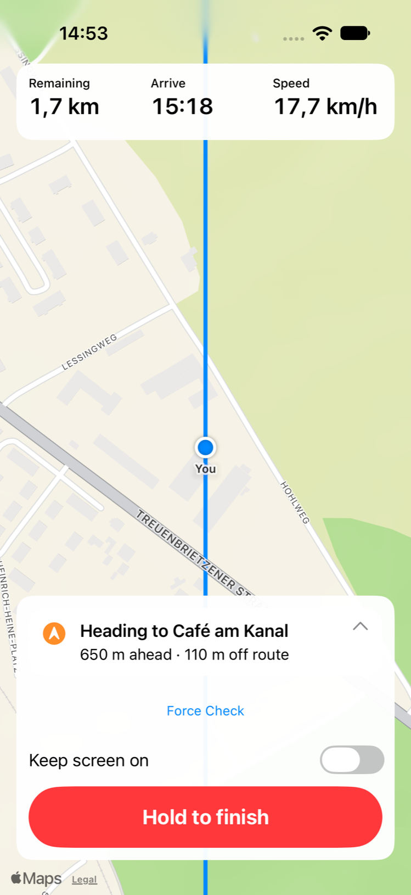
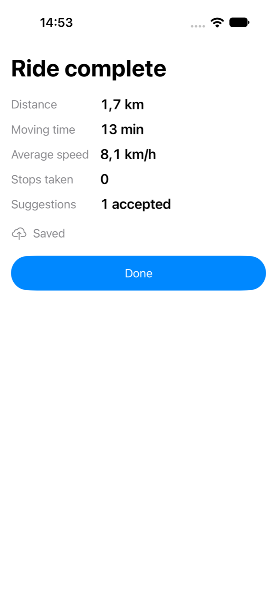
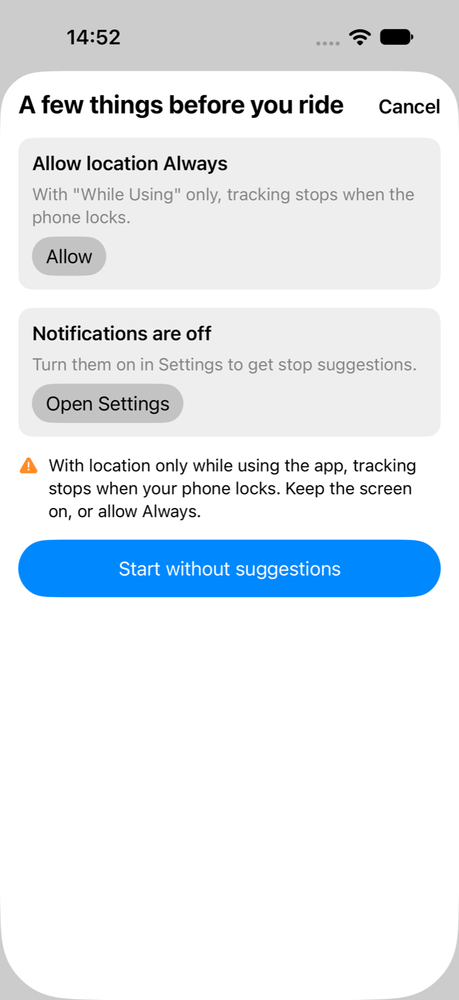
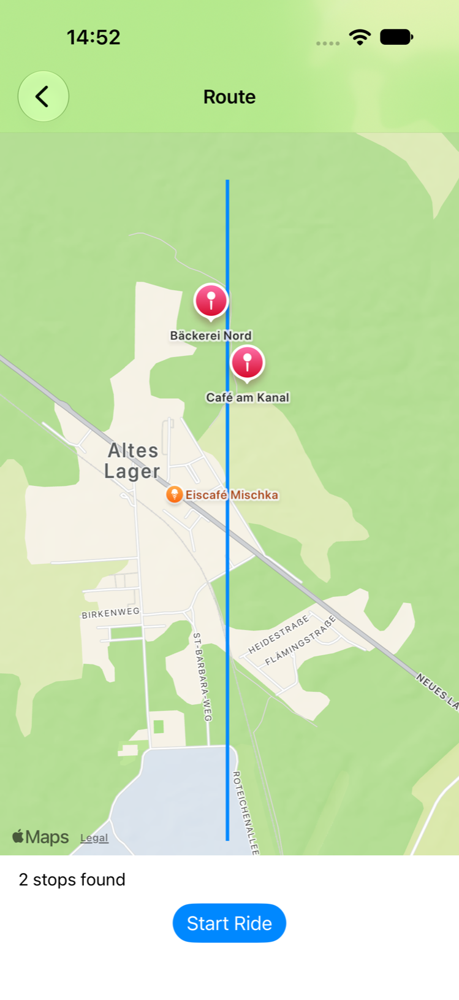

# Milestone 7 screens

Captured on 2026-10-22 by the UI tests on the iPhone 18 Pro simulator (iOS 27, German region, so
decimals use a comma). The data comes from the offline `-uiTestFixtures` mode: a seeded "Canal Loop"
route along the Demo Mode replay and a stub backend that always suggests the café.

| | | |
|---|---|---|
|  |  |  |
| **01 Home** — route card: name, distance, climbing, stop search, Start Ride, View map | **02 Demo Mode** — Debug builds only | **03 Live ride** — map-first dashboard: remaining, arrival time, speed; keep screen on; hold to finish |
|  |  |  |
| **04 Suggestion card** — stop, distance ahead, detour, advisor message | **05 Stop sheet** — Directions (Apple Maps), Accept, Decline; half height, pull up for full | **06 Heading to** — after Accept |
|  |  |  |
| **07 Ride summary** — figures, suggestion answers, upload status, Done | **08 Readiness check** — shown before Start only when a permission is missing | **09 Corridor map** — the stored route and its stops, with the stop-search state |

The blue "Force Check" link in 03–06 is a Debug-only developer control; it isn't in Release builds.

## Regenerating

```bash
TEST_RUNNER_SCREENSHOTS_DIR=/tmp/screens xcodebuild test \
  -project CyclingCompanion.xcodeproj -scheme CyclingCompanion \
  -destination 'platform=iOS Simulator,name=iPhone 18 Pro' \
  -only-testing:CyclingCompanionUITests/ScreenshotTourTests
for f in /tmp/screens/*.png; do sips -Z 1630 "$f" --out docs/screenshots/milestone-7/; done
```

`ScreenshotTourTests` also attaches every screenshot to the test result.
